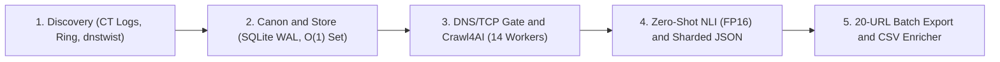

# domain-sieve


`domain-sieve` is a hardware-agnostic, single-node pipeline for automated discovery, browser rendering, and multilingual classification of illegal websites.
Built to saturate a single dedicated machine without cluster brokers or container orchestration, it ingests live Certificate Transparency (CT) logs, filters live hosts via async DNS/TCP checks, renders targets through a shared headless Chromium pool (`crawl4ai`), classifies pages across `judol`, `pinjol`, `phishing_scam`, `adult_ilegal`, and `other_ilegal` using FP16 zero-shot NLI (`MoritzLaurer/bge-m3-zeroshot-v2.0`), and exports deduplicated 20-URL batches with sharded JSON artifacts.

## Motivation

Server-scale OSINT and threat platforms evaluated in [repo-analysis.html](repo-analysis.html) rely on heavy multi-container stacks (Elasticsearch, Neo4j, Redis, RabbitMQ, MinIO) that overtax single-machine memory and omit deterministic URL canonicalization, Indonesian slang normalization, and compact batch export workflows.
`domain-sieve` replaces distributed broker overhead, multimodal VLM/OCR pipelines, and external CT daemons with one self-contained Python pipeline optimized for O(1) cross-run deduplication, continuous worker concurrency, and verifiable per-run telemetry.

## Architecture Overview




Benchmarks above were measured on a single CUDA-enabled machine (15 GiB RAM, 6 GB VRAM GPU, 12-thread CPU).
Details on module boundaries, state transitions, and architectural trade-offs live in [docs/architecture.md](docs/architecture.md) and [docs/decisions.md](docs/decisions.md).

## Quickstart

```sh
uv sync
uv run playwright install chromium
cp .env.example .env

# Run live discovery, crawling, GPU classification, and interactive Rich dashboard
uv run python -m sieve.run

# Export unexported high-confidence hits into 20-URL .txt batches
uv run python -m sieve.export
```

## Development & Commands

| Task | Command | Notes |
| :--- | :--- | :--- |
| Install | `uv sync && uv run playwright install chromium` | Installs Python dependencies, CUDA PyTorch, and headless Chromium |
| Run Pipeline | `uv run python -m sieve.run` | Auto-polls Cloudflare CT logs with live Rich terminal UI (`--doh`, `--dnstwist`, `--seed-file`, `--nrd-file`, `--no-ui`) |
| Test Suite | `uv run pytest tests/ -v` | Runs 48 unit and integration tests covering canonicalization, store dedup, pre-filter, discovery, export, and runner |
| Classifier Eval | `uv run python -m sieve.eval --backends nli` | Benchmarks local `bge-m3-zeroshot-v2.0` (and optional `jev` with `TYPESAFE_API_KEY`) on `data/eval/benchmark_set.jsonl` |
| Batch Export | `uv run python -m sieve.export --min-confidence 0.70` | Writes max-20 URL `.txt` files and `candidates.csv` under `data/exports/<YYYY-MM-DD>/` |
| CSV Enrichment | `uv run python -m sieve.enrich --input data/exports/<YYYY-MM-DD>/candidates.csv` | Appends 140-char Indonesian notes (`note_140_id`) and `mechanism_tag` using `DEEPSEEK_API_KEY` |
