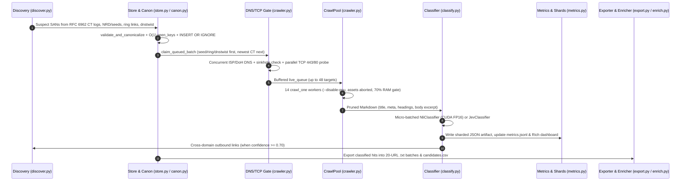

# Architecture Overview

`domain-sieve` is a single-node asynchronous pipeline designed for continuous or bounded collection sessions on a dedicated workstation or server without container orchestration or external message brokers.

## End-to-End Sequence

## Canonicalization & Persistence

`validate_and_canonicalize` in `sieve/canon.py` enforces strict URL constraints (`http`/`https`, maximum 300 characters, no embedded credentials, no ports, no raw IPs, no `localhost`) and generates the normalized `canonical_key` (strip scheme, strip leading `www.` only, lowercase hostname, strip query and fragment, strip trailing `/`, preserve case-sensitive path) plus its `canonical_hash` (`SHA-256`).

`SieveStore` in `sieve/store.py` manages a SQLite WAL database (`data/sieve.db`) with four tables (`urls`, `runs`, `eval_runs`, `source_cursors`).
On startup, `SieveStore` preloads all `canonical_key` values into an in-memory `seen_keys` set so `enqueue_many` rejects cross-source duplicates and rapid restart overlaps in `O(1)` time before touching SQLite.
`claim_queued_batch` prioritizes `seed`, `ring`, and `dnstwist` sources before `certstream` entries ordered newest-first (`discovered_at DESC`), while keeping crashed in-flight rows at `status = 'queued'` for automatic resume.

## Discovery & Backpressure

`sieve/discover.py` combines live Certificate Transparency polling with optional seed ingestion and active expansion:

- **Direct RFC 6962 CT Polling (`poll_ct_logs`):** Polls `ct.cloudflare.com/logs/nimbus2026/` and `nimbus2027/` (with dynamic `gstatic.com` log-list fallback), parsing X.509 `SubjectAlternativeName` and `CommonName` fields directly via `extract_domains_from_ct_entry`. Polling pauses when `store.count_queued()` reaches `3,000` (`max_queued`) and snaps the cursor forward to `tree_size - 1500` on resume so crawling stays on freshly issued certificates.
- **Stage 1 Pre-Sieve (`is_suspect_domain`):** Fast-rejects major benign platforms (`BENIGN_ROOT_DOMAINS`), government/education/internal suffixes (`BENIGN_TLD_SUFFIXES`), and parking subdomains (`^ww\d+\.`), while passing suspicious TLDs (`SUSPICIOUS_TLDS`), Indonesian/global illegal keywords (`_SUSPECT_DOMAIN_TOKENS`, segment-bounded `_BOUNDED_SUSPECT_TOKENS`), and mixed alphanumeric patterns (`_DIGIT_MIX_RE`) before running full canonical validation.
- **Expansion (`extract_ring_candidates`, `generate_dnstwist_candidates`):** High-confidence (`>= 0.70`) illegal hits feed up to `15` cross-domain outbound links per page back into `SieveStore` (capped at `max_hop_depth=2`) and optionally generate TLD/typo variants via `dnstwist`.
- **Batch Backfill (`ingest_nrd_file`, `fetch_crtsh_domains`, `consume_certstream`):** Supported for local NRD/seed files, optional `crt.sh` queries, or an external `certstream-server-go` WebSocket when explicitly enabled.

## Pre-Filter & Continuous Crawl Pool

`prefilter_live_targets` in `sieve/crawler.py` probes queued URLs before launching browser work.
DNS resolution defaults to local resolver (`aiodns`) so ISP/TrustPositif-blocked hosts fail fast as `nxdomain` or known sinkhole IPs (`TRUSTPOSITIF_SINKHOLE_IPS`); passing `--doh` switches both `resolve_host_ips` and Chromium DNS flags to `1.1.1.1`.
`check_tcp_liveness` probes ports `443` and `80` concurrently (`timeout_s=1.5`) so dead hosts drop before claiming a browser tab.

`CrawlPool` maintains one headless Chromium instance (`--disable-gpu`, `memory_saving_mode=True`, `max_pages_before_recycle=300`) and installs a Playwright `on_page_context_created` route handler aborting `image`, `media`, `font`, and `stylesheet` requests.
In `sieve/run.py`, `14` persistent `_crawl_worker` coroutines pull live targets from a bounded `live_queue` via `CrawlPool.crawl_one` (`page_timeout_ms=12000`, pausing whenever `psutil.virtual_memory().percent >= 70.0`), eliminating per-batch timeout barriers.
`is_trustpositif_block_page` and `is_dead_or_parked_page` filter ISP sinkholes, HTTP `>= 400` responses, empty shells, redirect stubs, and domain-for-sale pages prior to GPU inference, while `build_pruned_markdown` retains title, meta description, headings, and the first `1,500` body characters.

## Classification & Evaluation

`sieve/classify.py` defines a single `Classifier` protocol returning `ClassificationResult` across six categories (`judol`, `pinjol`, `phishing_scam`, `adult_ilegal`, `other_ilegal`, `benign`) plus an `is_id_targeted` signal (`detect_indonesian_targeting`).
Before inference, `normalize_indonesian_slang` expands obfuscated leetspeak (`jud0l`, `g4c0r`, `m4xw1n`, `b0kep`) and local jargon (`rungkad`, `nawala`, `galbay`, `open bo`, `vcs`) into explicit Indonesian anchors without altering standard multilingual text.

`NliClassifier` runs `MoritzLaurer/bge-m3-zeroshot-v2.0` in FP16 micro-batches (`batch_size=16`, `torch.inference_mode()`) on CUDA, computing `log_odds = entailment - not_entailment` across intent-aligned hypotheses and normalizing with `softmax`.
`JevClassifier` implements the same `Classifier` protocol against TypeSafe's `jev-1.14.0` `/decisions` endpoint.
`sieve/eval.py` benchmarks enabled backends on `data/eval/benchmark_set.jsonl` (60 labeled multilingual and hard-negative samples), logging precision, recall, F1, latency percentiles, estimated cost, and per-sample disagreements to `data/eval/reports/` and `eval_runs`.

## Metrics, Sharding, Export & Enrichment

`write_sharded_artifact` in `sieve/metrics.py` stores full extraction payloads under `data/scraped/<YYYY-MM-DD>/<category>/<hash[:2]>/<canonical_hash>.json` so directory listings remain small across tens of thousands of artifacts.
`RunMetricsTracker` appends periodic snapshots to `data/runs/<YYYY-MM-DD>/<run_id>/metrics.jsonl`, logs failures to `errors.jsonl`, and drives `build_live_dashboard` (`rich.live.Live` terminal telemetry in `sieve/run.py`).

`export_batches` in `sieve/export.py` queries unexported `status = 'classified'` hits above `--min-confidence` (default `0.70`, ordered by `is_id_targeted DESC, confidence DESC`), re-validates all URL constraints, writes max-20 URL `.txt` files alongside `candidates.csv`, and atomically marks rows `status = 'exported'`.
`enrich_candidates_csv` in `sieve/enrich.py` runs out-of-band against an OpenAI-compatible `DEEPSEEK_BASE_URL` endpoint to add 140-character Indonesian notes (`note_140_id`), `mechanism_tag`, and `enrichment_audit.jsonl`.

## Runtime Profile

Measured on a single CUDA-enabled machine (15 GiB RAM, 6 GB VRAM GPU, 12-thread CPU):

- **GPU Classifier (`bge-m3-zeroshot-v2.0` FP16):** ~`1.1-1.5 GB` VRAM, ~`163-190ms` median latency per page, `$0.00` marginal cost.
- **Process Footprint (`CrawlPool` + Python orchestrator + `seen_keys`):** ~`1.9 GB` RSS total, constrained below `70%` system RAM.
- **Measured Live Throughput:** `220.9` classified pages/min (`174.2ms` classify p50) observed in continuous 14-worker `crawl_one` mode.
