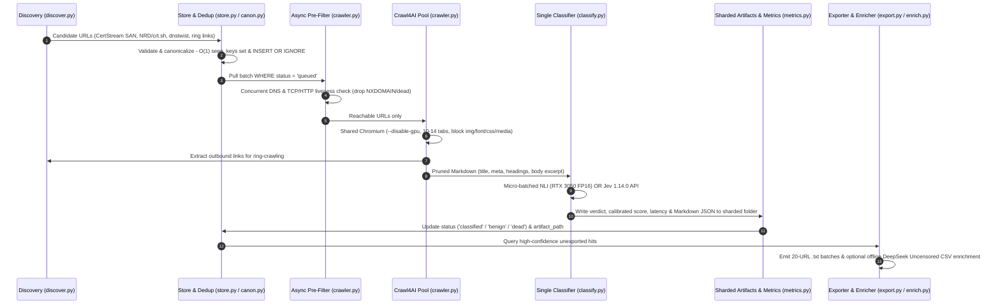

# Architecture Overview

`domain-sieve` is a single-node asynchronous pipeline designed to run in bounded batch sessions (e.g., 8-hour runs) on a Fedora 45 laptop without container orchestration or external databases.

## End-to-End Sequence



## Module Boundaries

- **`sieve/canon.py`:** Pure URL validation and canonicalization implementing the exact hackathon `Duplikat` rules (max 300 chars, `http`/`https`, no port/userinfo/IP/`localhost`, strip `www.` only, lowercase host, strip `?query`/`#fragment`/trailing `/`, case-sensitive path) plus `canonical_sha256` computation for sharded filenames.
- **`sieve/store.py`:** SQLite (WAL mode) persistence layer holding an in-memory `set[str]` of all known `canonical_key` values for O(1) duplicate suppression across sources and rapid restarts.
- **`sieve/discover.py`:** Combines backward seeds (NRD daily dumps, `crt.sh` historical queries, `dnstwist` permutations, user seeds) with forward streams (`certstream-server-go` SAN stream with a lightweight high-recall domain pre-sieve, plus outbound link extraction from crawled hits).
- **`sieve/crawler.py`:** Runs a high-concurrency `asyncio` DNS/TCP liveness gate first, then renders live URLs through a single `crawl4ai` `MemoryAdaptiveDispatcher` browser pool with static assets blocked and `--disable-gpu` set.
- **`sieve/classify.py`:** Exposes a single `Classifier` protocol with two swappable backends (`nli` via `MoritzLaurer/bge-m3-zeroshot-v2.0` FP16 batched on GPU, and `jev` via TypeSafe `jev-1.14.0` HTTP API) plus lightweight Indonesian *judol*/*pinjol* abbreviation normalization.
- **`sieve/eval.py`:** Runs deterministic A/B comparisons between `nli` and `jev` on a curated labeled dataset, recording precision, recall, F1, latency p50/p95, token cost, and per-sample disagreements.
- **`sieve/metrics.py`:** Appends structured per-run and per-stage counters (`metrics.jsonl` + SQLite `runs` table) and manages sharded scraped artifact storage.
- **`sieve/export.py`:** Emits submission-ready 20-URL `.txt` batch files (marking exported rows to prevent re-export) alongside a structured summary CSV.
- **`sieve/enrich.py`:** Separate, out-of-band CLI consuming exported CSVs and calling the 7-day Netra Runtime DeepSeek Uncensored OpenAI-compatible API to generate 140-character Indonesian summaries, mechanism tags, and Top-3 write-up evidence while logging enrichment runs.

## State Model (SQLite WAL)

```text
urls
- canonical_key   TEXT PRIMARY KEY
- canonical_hash  TEXT NOT NULL (sha256 hex of canonical_key)
- raw_url         TEXT NOT NULL
- source          TEXT NOT NULL (certstream | ring | dnstwist | nrd | crtsh | seed)
- status          TEXT NOT NULL (queued | dead | crawled | classified | benign | error | exported)
- http_status     INTEGER
- category        TEXT (judol | pinjol | phishing_scam | adult_ilegal | other_ilegal | benign)
- is_id_targeted  INTEGER (0 | 1)
- confidence      REAL
- classifier_id   TEXT (e.g. bge-m3-zeroshot-v2.0 | jev-1.14.0)
- artifact_path   TEXT (relative path inside data/scraped/)
- export_batch    TEXT (e.g. 2026-12-05/batch_0001.txt)
- discovered_at   TEXT NOT NULL (ISO-8601 UTC+7)
- crawled_at      TEXT
- classified_at   TEXT

runs
- run_id          TEXT PRIMARY KEY
- started_at      TEXT NOT NULL
- ended_at        TEXT
- mode            TEXT NOT NULL
- dns_mode        TEXT NOT NULL (isp | doh)
- classifier_id   TEXT NOT NULL
- counts_json     TEXT NOT NULL (discovered, deduped, dead, crawled, classified, exported, errors)

eval_runs
- eval_id         TEXT PRIMARY KEY
- created_at      TEXT NOT NULL
- dataset_path    TEXT NOT NULL
- classifier_id   TEXT NOT NULL
- metrics_json    TEXT NOT NULL (precision, recall, f1, p50_ms, p95_ms, est_cost_usd)

source_cursors
- source_name     TEXT PRIMARY KEY
- cursor_value    TEXT NOT NULL
- updated_at      TEXT NOT NULL
```

## Sharded Filesystem & Evidence Layout

Storing tens of thousands of scraped payloads in a single flat folder degrades directory listing and filesystem indexing.
Artifacts are therefore sharded by **run date**, **classification category**, and a **2-character hex hash prefix** of `canonical_hash`:

```text
data/
├── sieve.db                                        # SQLite WAL database
├── eval/
│   ├── benchmark_set.jsonl                         # Labeled EN + ID + hard-negative pages
│   └── reports/                                    # A/B comparison markdown + confusion CSVs
├── runs/
│   └── <YYYY-MM-DD>/
│       └── <run_id>/
│           ├── metrics.jsonl                       # Periodic throughput, memory, latency snapshots
│           └── errors.jsonl                        # Structured fetch/parse errors
├── scraped/
│   └── <YYYY-MM-DD>/
│       └── <category>/                             # judol | pinjol | phishing_scam | adult_ilegal | benign | error
│           └── <hash[:2]>/                         # 256 buckets max (~few dozen files per dir)
│               └── <canonical_hash>.json           # Raw URL, canonical key, headers, pruned Markdown, score
└── exports/
    └── <YYYY-MM-DD>/
        ├── batch_0001.txt                          # Max 20 canonical/valid URLs per file
        ├── candidates.csv                          # Full metadata export for triage/enrichment
        └── enriched_candidates.csv                 # Out-of-band DeepSeek Uncensored output + log
```

## Hardware Resource Budget (Laptop Target)

Target hardware from local host profile: Fedora 45, AMD Ryzen 5 6600H (12 threads), 14.92 GiB RAM (~9 GiB typically free), NVIDIA GeForce RTX 3050 6 GB VRAM, WiFi (`wlp4s0`).

- **Python orchestrator + SQLite + `certstream-server-go` + in-memory `seen_keys`:** ~200 MB RAM, < 5% CPU.
- **Async DNS/TCP liveness check:** ~50 MB RAM at 100-200 concurrent sockets.
- **`crawl4ai` shared Chromium (`--disable-gpu`, assets blocked):** ~1.5-3.0 GB RAM at 10-14 concurrent contexts (`MemoryAdaptiveDispatcher` ceiling at 70% system RAM), 0 MB discrete VRAM.
- **`bge-m3-zeroshot-v2.0` FP16 micro-batched inference (`batch_size=16..32`):** ~1.1-1.5 GB VRAM on RTX 3050, leaving ample VRAM headroom and preventing browser-GPU contention.
